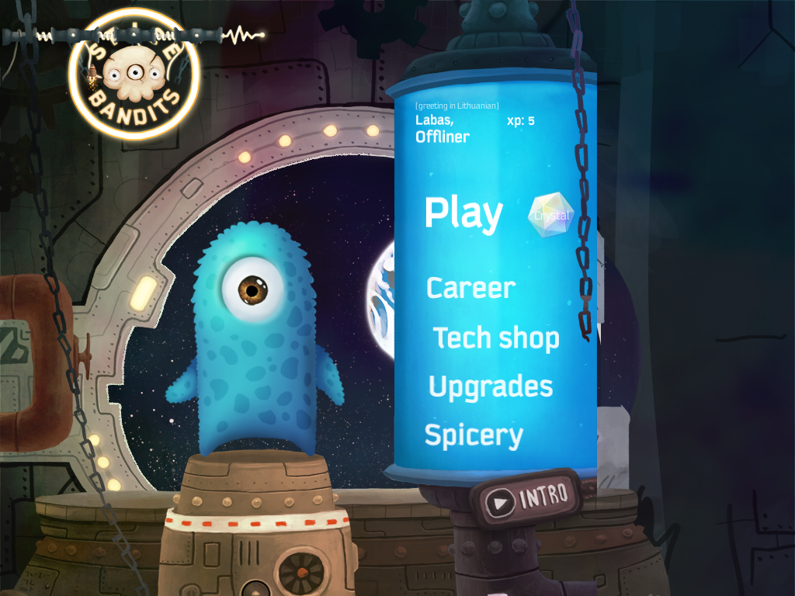
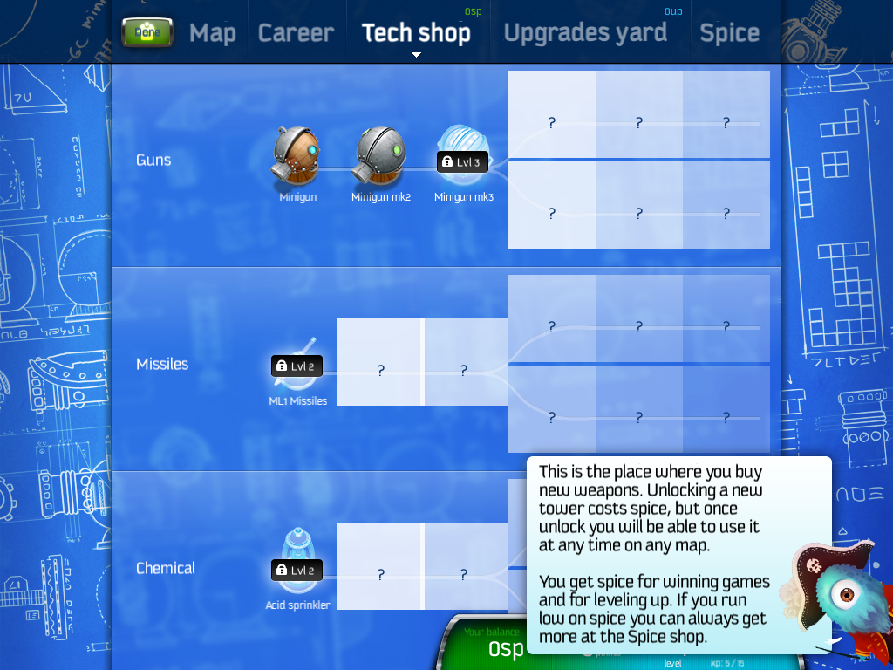
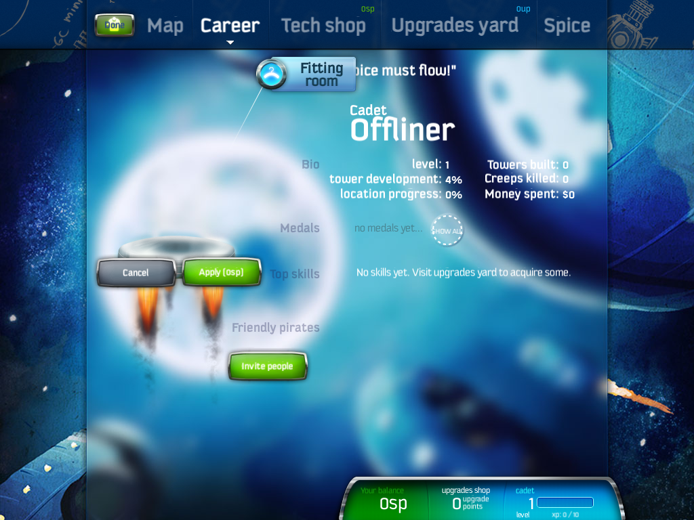
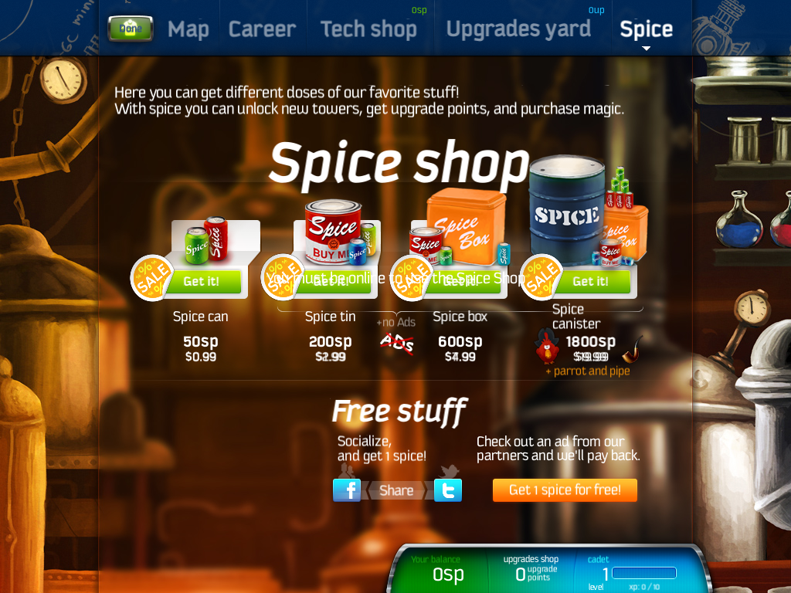
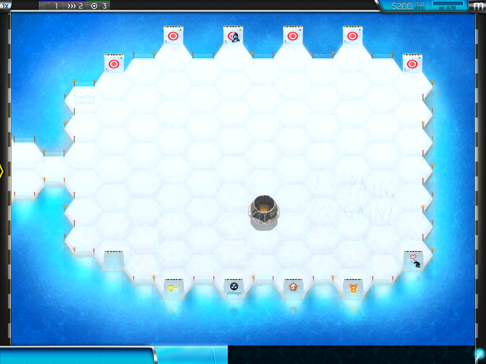
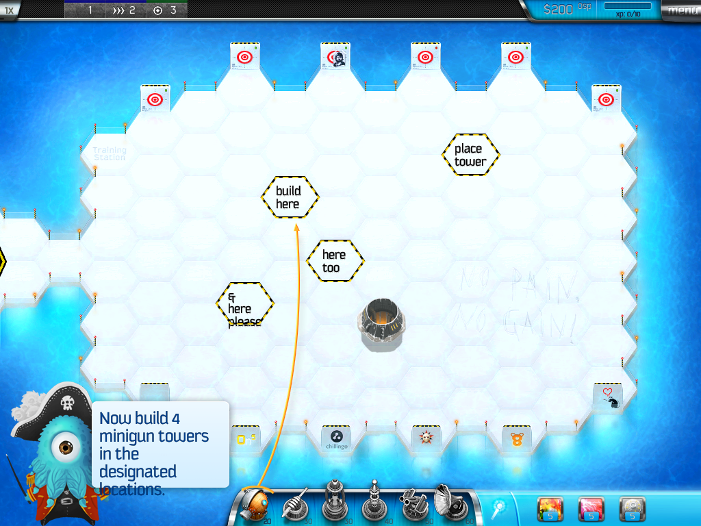
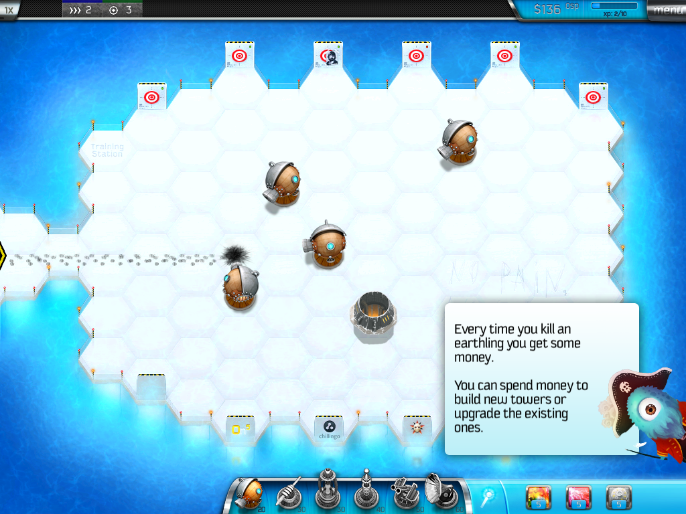
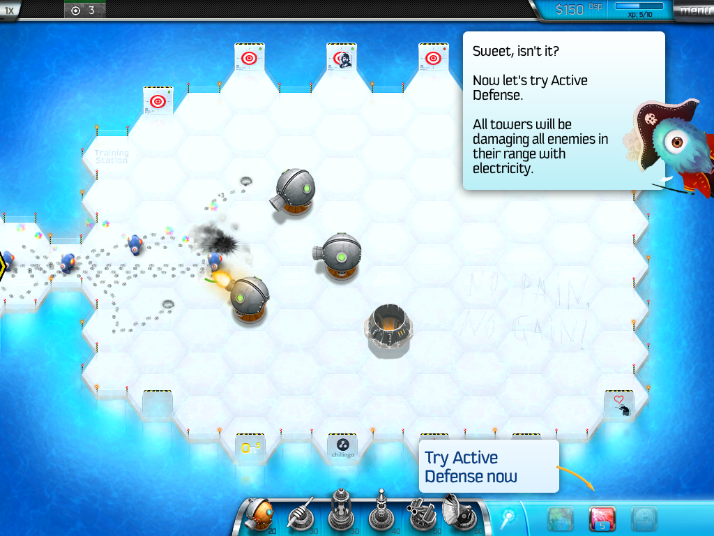

# Spice Bandits (iOS) on Linux

An attempt to bring Chillingo's abandoned iOS tower-defence game **Spice Bandits** (bundle `Tower`, v1.14, armv7) back to life on desktop Linux, with the original game code left untouched.

It is **not** a source decompilation. The original armv7 Mach-O runs unmodified inside a [Unicorn](https://www.unicorn-engine.org/) (QEMU TCG) CPU emulator, and this repo is the small "iOS" the game runs on: a Mach-O loader, an Objective-C runtime, UIKit/Foundation/CoreGraphics stand-ins, OpenGL ES 1.1 -> desktop GL, and mouse-as-touch input. The tooling in `tools/` lifts and documents the binary (functions, classes, imports, nibs) so the missing pieces can be found.

| | |
|---|---|
|  |  |
| Main menu (nib UI, animated) | World map (engine GL + UIKit overlays) |
|  |  |
| Tech shop (offline profile data) | Career screen with avatar |
|  |  |
|  |  |
|  | |
| Spice shop (offline StoreKit catalogue) | |

## Honest status

| Area | Status |
|---|---|
| Decompiled to readable source | **0 %** of the game. ~15,960 functions are catalogued and ~11,550 Objective-C methods named (`docs/`), but none are translated to C |
| Original code executed | 100 % of what runs is the original binary, via emulation |
| Platform layer (this repo's real code) | ~3,100 dense lines of C in `host/`; 0 unimplemented imports hit on the menu/map/shop/career path; ~15 unhandled Objective-C selectors still answered with nil |
| Boots to main menu | works |
| Main menu | renders, animations run (UIView animation engine); some nib leftovers hidden |
| World map | renders (iPad assets) with the Training flyout; the flyout icon is still missing |
| Tech shop | renders item trees from the offline profile; tabs and Done work |
| Career | layout and avatar match the original; progress is saved between runs (`defaults.bin`); fitting room and medals/friends not checked |
| Spice shop | shows the four items with prices (catalogue and prices are guesses; sale badges wrong) |
| Upgrades yard | not checked |
| In-level gameplay | **Training level plays**: tower bar and magic bar, drag-to-build, waves, creeps, upgrades, selling, disco / active-defense magic and the scripted tutorial prompts all work (verified by scripted play-through up to the mines step). Not yet verified: finishing the level, the win screen, saving xp and the unlock of the next level |
| Audio | not implemented (silent) |
| Pause menu | opens; `<<` works; Replay / To the map highlight but their confirmation dialog is not drawn yet |
| Network features | stubbed; the game runs on a bundled offline profile |
| Windows build | not started |

Rough overall estimate: **about 25 % of the way to a playable game** (menus, map, Training level and tutorial play; the rest of the levels, audio, win/lose screens and saving progress are unverified). This is a guess, not a measurement.

Curated map of understood functions: [`docs/KNOWN_FUNCTIONS.md`](docs/KNOWN_FUNCTIONS.md). Known blockers are tracked in [`docs/PORT_STATUS.md`](docs/PORT_STATUS.md).

## Running

You must supply your own copy of the game. Only the decrypted `Spice Bandits 1.14.ipa` works (the `...spicepirateshd...` IPA is FairPlay-encrypted). It is never committed here (`.gitignore`).

```sh
# needs: gcc, SDL2, SDL2_image, SDL2_ttf, SDL2_mixer, OpenGL, zlib, unicorn, python3 + capstone/lief (tools only)
./play.sh                       # unpacks the IPA, builds host/, runs   (Shift+Esc quits, F11 fullscreen)
./play.sh 2> /tmp/sb.log        # keep the log for bug reports
tests/run_tests.sh --quick      # static-analysis tests
tests/run_tests.sh              # + build, boot, screenshot-signature tests
```

Handy debug switches (environment variables): `RA_TRACE`, `RA_BREAK=addr,...`, `RA_DUMPREG=reg:lo:hi`, `RA_BLOCKS`, `RA_UIDUMP`, `RA_CLICKS="frame:x:y,..."`, `RA_SHOT=file RA_SHOT_FRAME=n`.

## Layout

```
host/    the iOS runtime stand-in (cpu, macho, objc, uikit, foundation, gles, sdl, ...)
tools/   binary analysis: function finder, ObjC dumper, selector xrefs, nib/PNG converters
docs/    generated catalogues (functions, classes, imports, HLE backlog) and PORT_STATUS.md
tests/   unit tests for tools + screenshot-signature goldens for the host
```

## Legal

Spice Bandits belongs to its rights holders. This project contains none of its code or assets; screenshots are included for documentation only.
